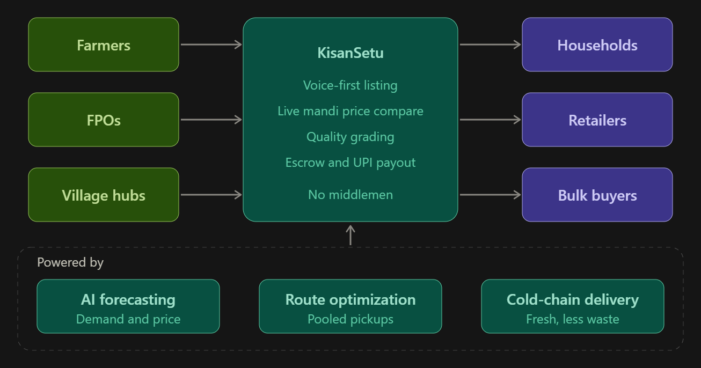

# Smart India Hackathon Workshop
# Date:24/11/2026
## Reference Number:26017521
## Name:Sugankumar K

## Problem Title
SIH 26033: Multiple intermediaries reduce farmers earnings and increase consumer prices.

## Problem Creater's Organization
Ministry of Consumer Affairs, Food & Public Distribution

## Theme
Agriculture, FoodTech & Rural Development

## Problem Description
Expected Solution: Create a digital marketplace that:

• Connects farmers/FPOs directly with consumers and bulk buyers.
• Provides logistics support.
• Uses AI for demand forecasting and route optimization.

Benefits:

• Better prices for farmers.
• Lower prices for consumers.
• Reduced supply chain inefficiencies.

## Proposed Solution
Sell directly: Farmers and FPOs list their crops in their own language, by voice or text, and sell straight to families, shops, and big buyers. No middlemen taking a cut.
Fair prices, clearly shown: Every listing shows today's mandi price next to our price, so farmers see what they gain and buyers see what they save.
Easy pickup and delivery: Crops are collected from the village or FPO centre, combined with other orders, and delivered fresh. Perishable items travel in cold storage.
Smart planning with AI: The app tells farmers what is likely to sell, when prices may rise, and the cheapest, fastest route to deliver, so less produce goes to waste.
Safe and quick payment: The buyer's money is held safely and sent to the farmer's bank account through UPI within 1 to 2 days after delivery.

## Technical Approach
Frontend and accessibility: Flutter (or React Native) apps for farmers, FPOs, and buyers, with offline-first storage and sync, plus Bhashini APIs for regional-language voice and text input.
Backend and data layer: FastAPI microservices for listings, orders, payments, and user management, backed by PostgreSQL with PostGIS for geospatial queries, Redis for caching, and a message queue for async order and logistics events.
Data integration: Live ingestion of mandi prices and arrivals from Agmarknet/eNAM, weather from IMD, and festival/seasonality calendars, feeding a central feature store for the ML models.
AI/ML services: LightGBM/Prophet time-series models for demand and price forecasting, a CNN-based image model for produce quality grading and spoilage scoring, and Google OR-Tools for vehicle routing with capacity, time-window, and shelf-life constraints.
Payments, logistics, and deployment: Razorpay/UPI escrow with automatic farmer payouts, GPS-based tracking through partner fleet APIs, and containerized deployment (Docker, Kubernetes) on cloud infrastructure with monitoring and secure role-based access

## Feasibility and Viability

Technology is ready: Everything we need already exists. Mobile apps, UPI payments, Bhashini for regional languages, and open-source AI tools like Prophet, LightGBM, and Google OR-Tools can all be used directly.
Data is available: Daily mandi prices and arrivals come from Agmarknet and eNAM, and weather data comes from IMD, so the AI models have real data to learn from.
Existing farmer network: Thousands of FPOs already exist in India. We can onboard farmers through them instead of reaching each farmer one by one.
Low-cost start: We begin with one region and 2 to 3 crops, using partner delivery vehicles instead of buying our own fleet.
Sustainable income: A small 2 to 4% commission, a shared logistics margin, and paid analytics for FPOs and bulk buyers keep the platform running.
Challenges and fixes:
Small loads are costly to move: we combine orders and pool pickups.
Quality disputes: we use photo grading and a rating system.
Farmers with low digital skills: we offer voice support, offline mode, and FPO help desks.
Trust in payments: we hold buyer money safely and release it quickly.
## Impact and Benefits
Impact on the target audience

Farmers and FPOs: Better prices, payment within 1 to 2 days, and guidance on what to grow and when to sell.
Consumers: Fresher vegetables and fruits at lower prices, with clear information about where the produce came from.
Bulk buyers (shops, hotels, institutions): Steady supply, fair rates, and the option of advance contracts.

Benefits

Economic: Farmers keep a larger share of the final price, buyers pay less, and the extra middleman margin is reduced.
Social: Smallholder farmers get fair access to the market, and rural youth and FPOs get new digital and logistics jobs.
Environmental: Fewer wasted crops, fewer half-empty trips, and lower fuel use through route planning.
Food security: Better matching of surplus areas to demand areas keeps supply stable and prices steady.

## Research and References
Agmarknet (Government of India), daily mandi prices and arrivals: https://agmarknet.gov.in
eNAM (National Agriculture Market), online trading platform for mandis: https://enam.gov.in
Bhashini (Government of India), regional language and voice technology: https://bhashini.gov.in
Google OR-Tools, open-source tool for vehicle routing: https://developers.google.com/optimization
Prophet (Meta), time-series forecasting library: https://facebook.github.io/prophet
SFAC (Small Farmers' Agribusiness Consortium), FPO promotion and support: https://sfacindia.com
IMD (India Meteorological Department), weather data: https://mausam.imd.gov.in
ICAR-CIPHET, research on post-harvest losses of fruits and vegetables: https://ciphet.icar.gov.in

